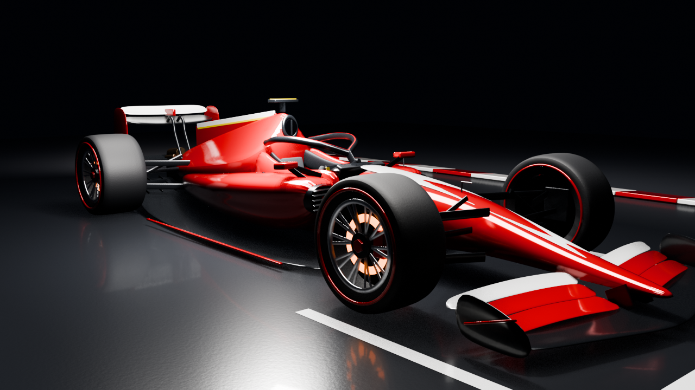
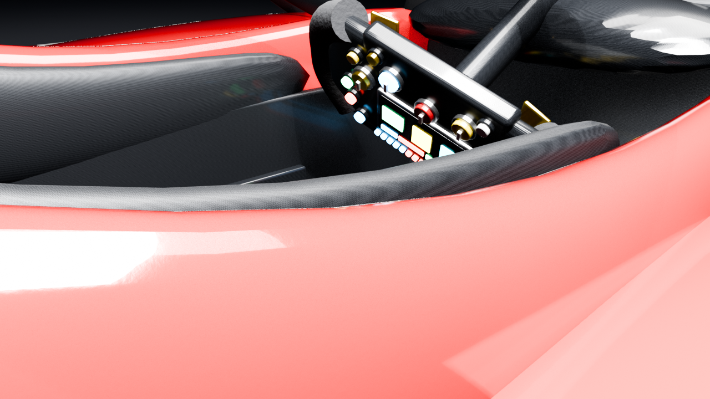
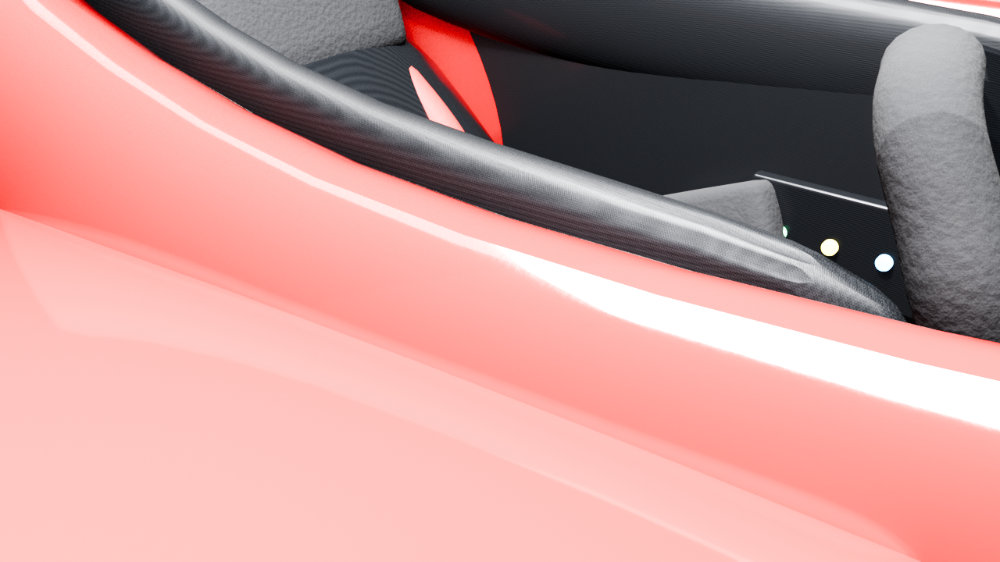
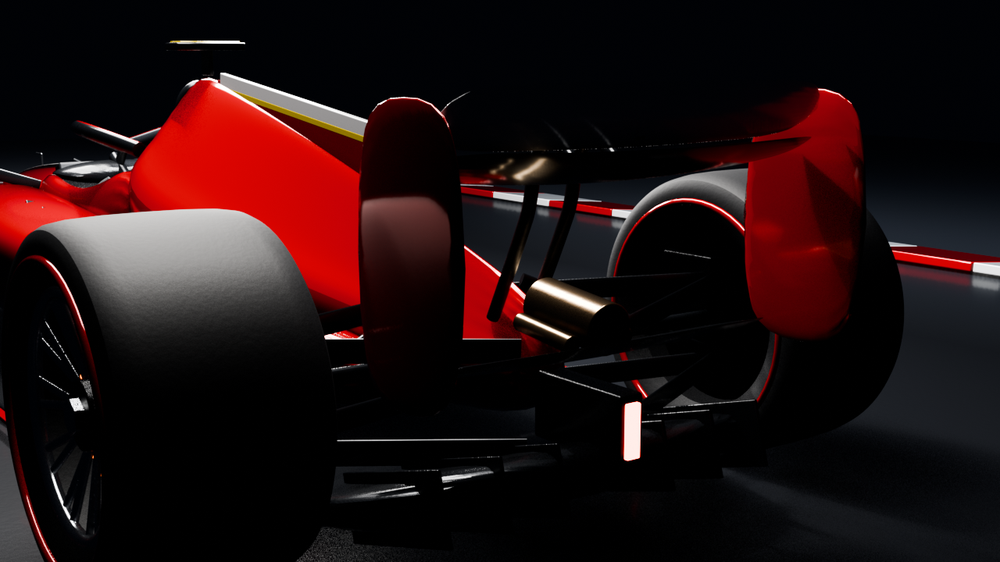
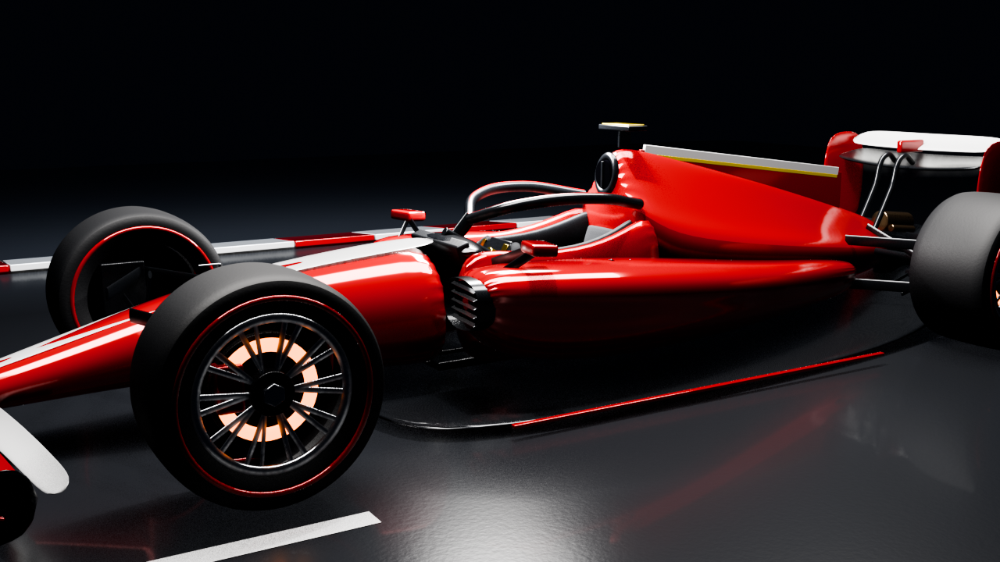

# F1 in Blender — test di Gemini 4 Argon

Monoposto di Formula 1 modellata in **Blender** da **Gemini 4 Argon** (Antigravity), come **test**:
modello 3D con interni (volante, sedile, cinture, pedaliera) e un video di 10 secondi
che gira intorno alla macchina e zooma nell'abitacolo.

Tutto generato da uno script Python, da zero.

## Voto: ⭐⭐⭐☆☆ (3/5)

## File

| File | Cosa è |
|---|---|
| `f1_showcase_10s.mp4` | Video, 10 s, 1280×720, 30 fps |
| `f1_macchina_bella.blend` | Progetto Blender (aprire con Blender 5.x) |
| `crea_f1.py` | Lo script che costruisce la macchina e renderizza il video |
| `anteprime/` | Render fissi di controllo |

## Video

https://github.com/francescoquirino/f1-blender-gemini4-argon/raw/main/f1_showcase_10s.mp4

## Anteprime







## Rifarlo

```bash
blender --background --python crea_f1.py
```
